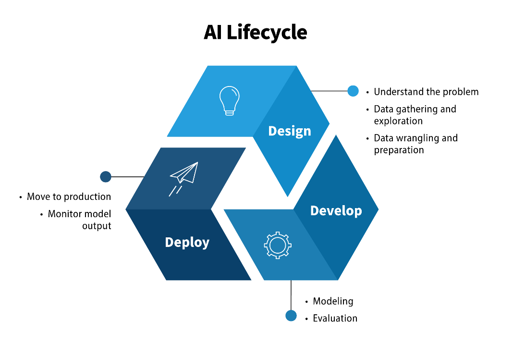

<h2 align="center">📖 Introduction to Artificial Intelligence</h2>

<em>Purpose: Build a clear foundation for what AI is, what tasks it can perform, and how it differs from ordinary automation.</em>

### Learning Outcomes
- Define AI in their own words.
- Recognize common AI-enabled applications.
- Distinguish AI, automation, and robotics at an introductory level.
- Explain why not every automated digital feature is necessarily AI.
  
#### 1.1 What is Artificial Intelligence?
Artificial Intelligence (AI) is a broad field concerned with creating computer-based systems that perform tasks commonly associated with human abilities, such as recognizing patterns, processing or generating language, making predictions, planning, and supporting decisions. 

There is no single definition used in every context. For this module, AI means the design and use of computational systems that perform tasks involving capabilities such as perception, learning, reasoning, language processing, or decision support.

#### 1.2 What can AI systems do?
- Perception: analyze images, video, audio, or sensor information; for example, identifying objects in a photograph.
- Language processing: classify, translate, summarize, or generate text and speech.
- Prediction: estimate a likely future value or category from patterns in data, such as traffic conditions.
- Recommendation: rank or suggest items based on user activity or similarities.
- Planning and decision support: compare possible actions under defined goals or constraints.
  
#### 1.3 AI, automation, and robotics
Automation means that a task is carried out with limited manual effort. It can be based on fixed rules and does not automatically require AI. A thermostat that switches heating on at a set temperature is rule-based automation. 

AI may be used when a system learns patterns from data or makes predictions in less predictable situations. Robotics concerns machines that sense and act in the physical world. A robot may use AI, but many robots perform pre-programmed actions; AI can also exist entirely as software.

#### 1.4 Traditional rule-based software versus AI
Traditional software often follows explicit instructions written by a programmer: if a condition is met, perform a specified action. 

In Machine Learning, developers provide data and a learning procedure so a model can identify patterns useful for a task. This distinction is useful but not absolute: real systems may combine fixed rules, databases, conventional software, and learned models.

#### 1.5 A simple AI system lifecycle
- Identify a task or problem.
- Select an approach and gather appropriate data or define rules.
- Build, test, and evaluate the system or model.
- Deploy it in a real context to produce outputs or recommendations.
- Monitor performance, handle failures, and update the system when needed.

  
#### 1.6 Why context matters
An AI system should be evaluated by its purpose, input data, operating environment, users, and possible consequences. A recommendation used to suggest a film has different risks from a model that helps prioritize medical cases or screen job applicants.

### Worked Example
Compare a streaming recommendation system with a digital countdown timer. A recommendation system may use patterns in viewing histories and similarities between users or items to rank films. A timer normally follows a fixed instruction: count down from a chosen value and signal when it reaches zero. Both are automated digital functions, but only the first clearly illustrates a common data-driven AI application.

### Try it: learning activity
Create an “AI, automation, or uncertain?” card sort. Give learners examples such as spam filtering, a fixed alarm clock, face unlock, a basic calculator, a movie recommender, a washing-machine preset, speech recognition, scheduled email, a chatbot, and traffic prediction. 

Learners classify each and explain what evidence would help them decide.

### Check your Understanding
  1. What does Artificial Intelligence broadly refer to?
  2. Give two examples of AI-enabled services.
  3. How is a fixed-rule timer different from a data-trained recommendation system?
  4. Can a robot exist without AI? Explain.
  5. Why should a healthcare AI system be evaluated differently from a film recommender?

### Common Misconceptions to Avoid
-	AI always means a human-like robot.
-	Every automated device or digital feature uses AI.
-	AI systems always learn while being used; some are trained earlier and then deployed.
-	An AI output is automatically correct or objective.
  
### Key Takeaways
-	AI is a broad field and has no single definition that fits every context.
-	AI can work as software, physical devices, or parts of larger services.
-	Automation and robotics overlap with AI but are not synonyms.
-	Evaluate AI in the context where it is used, not only by its technical label.
