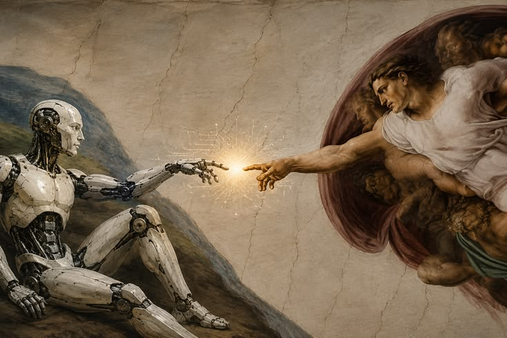
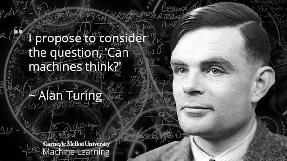
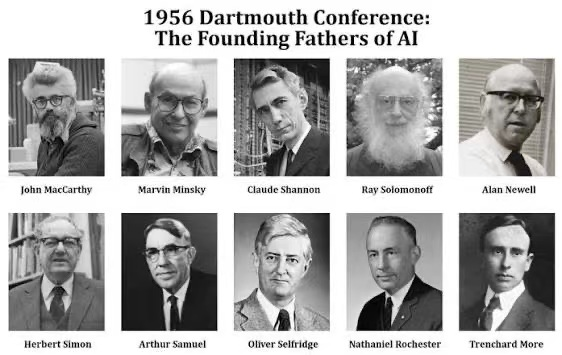

<h2 align="center">⏳ History and Development of AI</h2>

<em>Purpose: Show how AI developed through successive research approaches, periods of optimism, setbacks, and technical advances.</em>

 

### Learning Outcomes
-	Identify selected milestones in AI history.
-	Explain the significance of the 1950 Turing paper and the 1956 Dartmouth workshop.
-	Describe the idea of an AI winter.
-	Explain how data, algorithms, and computing power contributed to recent progress.

#### 2.1 Before AI became a named field
Long before modern computers, people imagined machines that could calculate, reason, or imitate aspects of human activity. In the twentieth century, developments in mathematical logic, computing theory, statistics, neuroscience, and engineering helped make machine intelligence a scientific research question.

#### 2.2 Alan Turing and the question of machine intelligence
In 1950, mathematician Alan Turing published “Computing Machinery and Intelligence.” Rather than relying only on an abstract debate about whether machines can think, he proposed an imitation-game approach: evaluate whether a machine's conversational responses could be mistaken for a human's under specified conditions. 

The Turing Test became influential in discussions about machine intelligence. Passing a conversational test would not prove consciousness or human-like understanding.

#### 2.3 The Dartmouth workshop and the naming of AI
The 1956 Dartmouth Summer Research Project is widely regarded as a foundational event in AI as a formal research field. The term “artificial intelligence” was used in the proposal associated with John McCarthy and colleagues. Researchers explored whether aspects of learning and intelligence could be described precisely enough for machines to simulate them.

#### 2.4 Early symbolic and rule-based AI
Early AI research often represented knowledge through symbols, logical statements, and hand-written rules. Such systems could solve structured problems, prove certain theorems, or perform tasks in limited environments. They worked best when the problem and its rules could be described clearly, but struggled with ambiguity, incomplete information, and real-world complexity.

#### 2.5 AI winters
An AI winter is a period when enthusiasm, investment, or research funding declines after expectations exceed what available methods and computers can deliver. AI experienced periods of reduced confidence and support. These setbacks did not mean all AI research stopped; rather, they showed that ambitious claims and practical capabilities were not always aligned.

#### 2.6 Growth of Machine Learning
Researchers increasingly developed methods that learned statistical patterns from examples instead of relying only on hand-written rules. Improvements in algorithms, data collection, storage, and computing helped Machine Learning become central to practical AI applications.

#### 2.7 Deep Learning and the modern era
From the 2010s, deeper neural networks achieved major improvements in image recognition, speech processing, and language tasks. Large datasets, specialized hardware, improved training methods, and research advances all contributed. 

In the 2020s, generative models brought text, image, audio, and other content generation into wider public use.

#### 2.8 History is not a simple straight line
AI progress has not been a steady march from simple to perfect intelligence. Different approaches have succeeded in different contexts, and each has limitations. New systems often combine older ideas with new data, hardware, algorithms, and engineering.

### Worked Example
A selective timeline: 

  1950 — Turing publishes his paper on machine intelligence; 
  
  1956 — Dartmouth workshop helps establish AI as a research field; 
  
  Later decades — symbolic systems and expert systems develop alongside periods of reduced expectations; 
  
  Subsequent decades — statistical Machine Learning becomes increasingly influential; 
  
  2010s — Deep Learning drives advances in perception and language; 2020s — Generative AI tools become widely visible. 

This is a teaching timeline, not a complete history.

### Try it: learning activity
Give groups shuffled milestone cards. Learners place them in chronological order and add one sentence explaining what changed at each stage. Ask which factor mattered most in a selected period: data, algorithms, computing power, research ideas, or practical demand.

### Check your Understanding
  1. What question did Alan Turing explore in his 1950 paper?
  2. Why is the 1956 Dartmouth workshop important?
  3. What does AI winter mean?
  4. Name two factors that helped modern Deep Learning develop.
  5. Why is it inaccurate to say that AI began with public chatbots in the 2020s?

### Common Misconceptions to Avoid
- The Turing Test proves consciousness or human-like understanding.
- The Dartmouth workshop created every AI technique used today.
- AI winters mean no research or progress occurred.
- Modern AI progress is caused by computing power alone.

### Key Takeaways
-	AI has roots decades before today's generative tools.
-	The 1950 Turing paper and 1956 Dartmouth workshop are important milestones.
-	AI research has experienced enthusiasm and periods of reduced expectations.
- Recent advances reflect combined effects of data, algorithms, hardware, and engineering.
