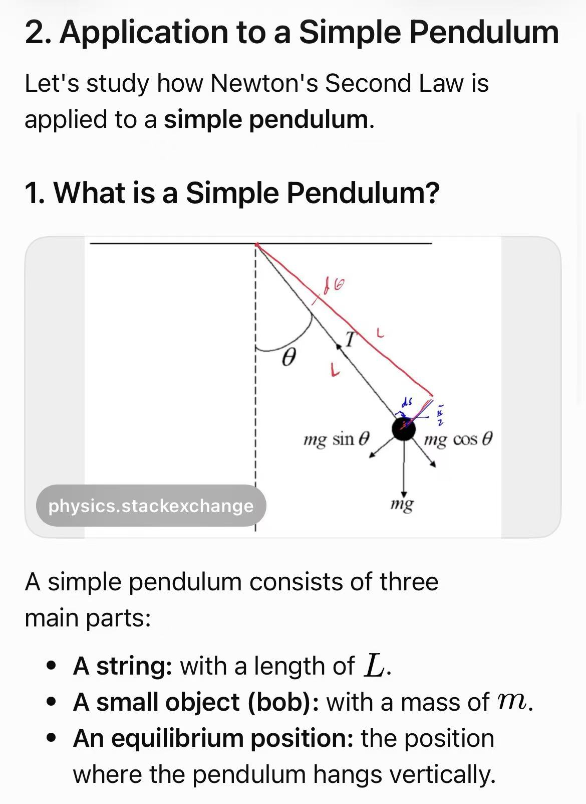
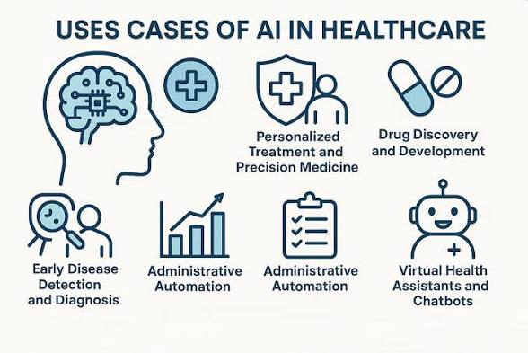
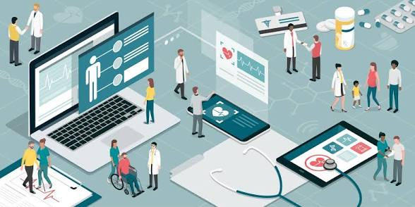
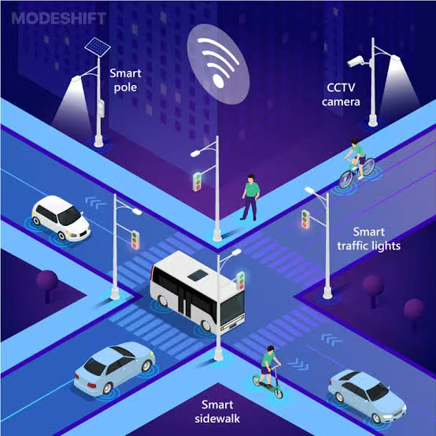
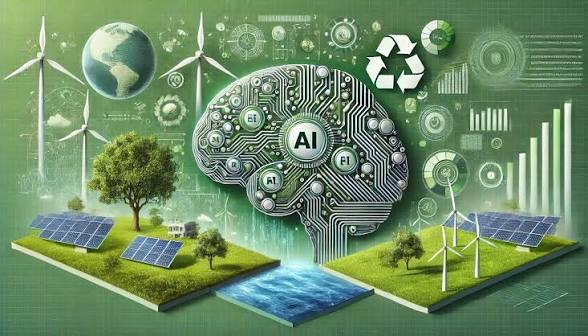
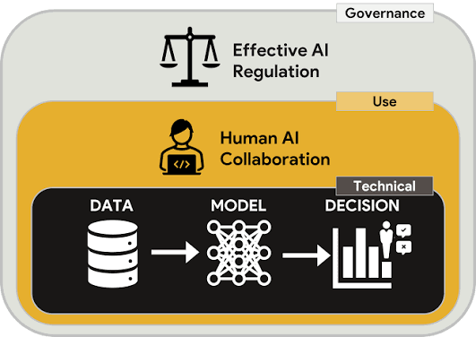

<h2 align="center">🧩 Real-World Applications of AI</h2>

<em>Purpose: Connect technical ideas to real-world problems and evaluate how AI supports people and organizations in different sectors.</em>

### Learning Outcomes
- Identify AI applications in at least five sectors.
- Explain the problem, input data, AI capability, and output in a use case.
- Recognize that AI is often one component in a larger human and technical system.
- Evaluate benefits, limitations, and safeguards in context.

#### 7.1 A framework for understanding an AI application
For each application, ask: What problem is being addressed? What data is used? What AI capability is involved? What output does the system provide? Who acts on that output? What could go wrong? How is performance checked? This prevents “AI is used here” from becoming an incomplete explanation.

#### 7.2 Education
AI tools can support practice-question generation, language assistance, feedback, accessibility, and personalized learning recommendations. They may help teachers prepare materials or identify topics where learners need support. Risks include inaccurate explanations, overdependence, privacy concerns, unequal access, and academic-integrity problems. Teachers and learners should check outputs and follow school policies.

#### 7.3 Healthcare
AI can assist with medical-image analysis, organizing information, research, and some administrative workflows. Its role depends on the specific tool and evidence for its intended use. Medical AI requires careful validation, privacy protection, monitoring, and qualified professional oversight. An AI result should not be treated as a diagnosis or treatment decision without appropriate clinical review.

#### 7.4 Transportation
AI-enabled systems can support route recommendations, traffic forecasting, driver assistance, fleet planning, and research into autonomous vehicles. Applications depend on sensor data, maps, traffic conditions, and system design. Errors can have physical consequences, so reliability, testing, safety engineering, and human responsibility are essential.

#### 7.5 Business and finance
Organizations may use AI for demand forecasting, customer-service support, fraud or anomaly detection, document processing, recommendations, and data analysis. Financial and business decisions can affect people's access to services or money. Models should be tested for errors and unfair impacts, and important decisions may require human review and appeal mechanisms.

#### 7.6 Agriculture and the environment
AI may help monitor crop health, identify pests, estimate yields, optimize irrigation, analyze satellite imagery, and support environmental monitoring. Benefits depend on data quality, connectivity, local conditions, affordability, and whether recommendations are practical for farmers and communities.

#### 7.7 Entertainment and everyday services
Recommendation systems can rank music, films, videos, products, or news based on user behaviour and item characteristics. They can make discovery easier, but may narrow what users see, reinforce preferences, or prioritize engagement over quality. Recommendations are selected outputs, not neutral windows onto everything available.

#### 7.8 AI is part of a sociotechnical system
An AI application includes more than a model. It also includes people, data collection, user interfaces, organizational rules, infrastructure, monitoring, and decision processes. A technically accurate model can still cause harm if used for the wrong purpose or if people misunderstand its limitations.

### Worked Example
A route-planning service estimates travel time and suggests a route. It may use road-network data, current or historical traffic information, location inputs, and prediction algorithms. The output is a recommendation, not a guarantee. Road closures, accidents, weather, or inaccurate location data may change the best route. The user remains responsible for following road rules and driving safely.

### Try it: learning activity
Industry case-study challenge: groups choose education, healthcare, transport, business, agriculture, or entertainment. They complete a canvas with six fields: problem, data, AI capability, output, expected benefit, and possible risk/safeguard. Each group gives a one-minute explanation and identifies one situation where human judgment remains important.

### Check your Understanding
  1. Name three sectors where AI is used and give one example for each.
  2. What information might a route-planning system use?
  3. Why must healthcare AI be evaluated and monitored carefully?
  4. Why is an AI model only one part of a larger sociotechnical system?
  5. Give one benefit and one risk of recommendation systems.

### Common Misconceptions to Avoid
-	Every application marketed as AI uses the same technology.
-	AI outputs should automatically replace professional judgment in high-impact contexts.
-	A model that works in a laboratory will necessarily work equally well everywhere.
-	Recommendations are neutral and show every possible option.

### Key Takeaways
-	AI is applied to different problems using different methods and data.
-	Every use case should be evaluated in its real context.
-	High-impact applications need validation, monitoring, safeguards, and appropriate human oversight.
-	AI supports people and organizations; it does not remove responsibility.
