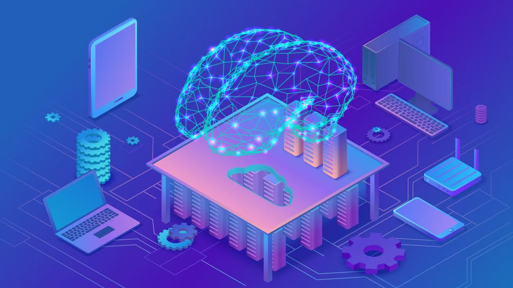

<h2 align="center">🚀 The Future of AI</h2>

<em>Purpose: Understand future AI developments, their potential impacts, and the challenges they may bring.</em>

### Learning Outcomes
- Identify current directions that may influence AI development.
-	Distinguish observed trends from forecasts and speculation.
-	Discuss possible effects on education, work, creativity, and society.
-	Explain why governance, skills, and human choices shape AI's future.

#### 9.1 Trends to watch
-	Multimodal systems: models that work across combinations of text, images, audio, video, and other inputs.
-	AI agents and tool use: systems designed to plan and carry out sequences of actions using software tools, often with human-defined permissions and supervision.
-	Smaller and more efficient models: models designed to run with lower computing or energy requirements or on local devices.
-	AI in science and engineering: systems that assist with data analysis, simulation, design, and research workflows.
-	Robotics and embodied AI: systems that connect perception and decision-making with physical actions.
-	Evaluation and governance: stronger attention to reliability, safety, transparency, privacy, and accountability.

#### 9.2 Possible effects on education
AI may support individualized practice, language assistance, accessibility, feedback, and teacher preparation. It may also make it easier to produce incorrect or unoriginal work and create privacy and fairness concerns. 

Education systems will need to decide which uses support learning, which require disclosure, and which should be restricted. Human relationships, critical thinking, subject knowledge, and assessment design remain important.

#### 9.3 Possible effects on work
AI may automate parts of some tasks, change workflows, create new roles, and increase demand for skills such as problem framing, data literacy, communication, domain expertise, critical evaluation, and collaboration with digital tools. 

Effects will differ by occupation, organization, country, and policy environment. It is more accurate to discuss tasks and changing job requirements than to claim that AI will simply replace every job.

#### 9.4 Creativity and human contribution
Generative tools can help people explore ideas, create drafts, and prototype content. Questions remain about authorship, attribution, intellectual property, consent, originality, and economic effects on creative communities. Human goals, taste, cultural knowledge, and accountability continue to shape how generated content is selected and used.

#### 9.5 AGI and long-term scenarios
Some researchers and commentators discuss the possibility of future systems with broader general capabilities. These scenarios involve uncertainty about definitions, timelines, technical feasibility, and social consequences. 

Students should distinguish current demonstrated systems from forecasts and hypothetical futures. A responsible discussion considers potential benefits and risks without presenting speculation as fact.

#### 9.6 What should society prepare for?
Preparation includes education and reskilling, robust evaluation, privacy and security practices, public participation, clear responsibility, and institutions capable of responding to changing technology. Technical development is only one part of the future; laws, business choices, cultural values, and public decisions also matter.

#### 9.7 A framework for evaluating predictions
-	Is the statement describing an existing capability, a measured trend, a forecast, or a hypothetical scenario?
-	What evidence supports it? Is the source reliable and recent enough?
-	What assumptions does the prediction depend on?
-	Who may benefit, and who may face costs or risks?
-	What alternative outcomes are plausible?

### Worked Example
Consider the statement: “AI will replace all teachers within ten years.” This is a prediction, not an established fact. A better analysis asks which teaching tasks AI may support or automate, which tasks depend on human relationships and professional judgment, what evidence exists, how schools may adopt tools, and what policies or social choices could change the outcome.

### Try it: learning activity
Run a “Future forecast with evidence” activity. Learners choose education, healthcare, transport, or creative work. They write one possible AI development, label it as an observed trend or prediction, list two pieces of evidence they would need, and identify one possible benefit and one risk. Revise overconfident statements into cautious, evidence-based predictions.

### Check your Understanding
  1. Name three AI trends that may influence future systems.
  2. Why is it better to discuss how AI changes tasks rather than claim that it will replace every job?
  3. What is the difference between an observed trend and a hypothetical scenario?
  4. Give one possible benefit and one possible risk of AI in education.
  5. What skills may help people work responsibly with AI tools?
  6. Why should predictions about AGI or future superintelligence be presented cautiously?

### Common Misconceptions to Avoid
- Every forecast about AI is a fact.
- AI development is determined by technology alone, regardless of policy or society.
- AI will affect every job in the same way.
- Current generative systems prove that AGI or ASI has been achieved.

### Key Takeaways
-	AI's future will be shaped by technical progress and human decisions.
-	Discuss specific tasks, contexts, and evidence rather than making sweeping claims.
-	Separate demonstrated capabilities from forecasts and hypothetical scenarios.
-	Education, critical thinking, governance, and responsible design will influence outcomes.
